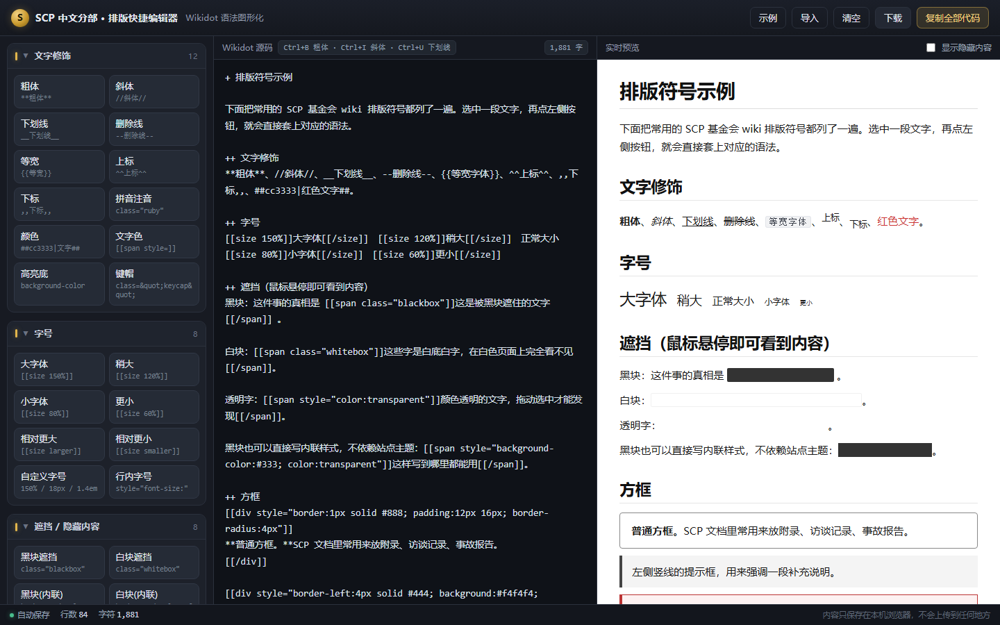

# SCP 中分分部 · 排版快捷编辑器

一个**单文件、纯前端**的图形化 Wikidot 编辑器：左边点按钮，就能给选中的文字套上 SCP 基金会 wiki 的排版符号（删除线、大/小字体、黑块白块遮挡、方框、折叠、标签页、表格……），右边实时预览。

不用记语法，也不用装任何东西——浏览器打开 `index.html` 就能用。

## 快速开始

**在线直接用**：<https://wtwgo114514.github.io/scp-wiki-editor/>

或者本地打开：

1. 下载 `index.html`（或 `git clone` 本仓库）
2. 双击用浏览器打开
3. 选中一段文字 → 点左边对应的按钮；没选中就直接点，会插入带占位符的模板，占位符已经选中，直接打字替换

内容会自动保存在浏览器本地（localStorage），换电脑或清理缓存前记得用「下载」导出备份。

## 常用语法速查

SCP 基金会 wiki 用的是 Wikidot 语法，常被问到的几个「符号」其实是这样的：

| 效果 | 原始语法 | 说明 |
| --- | --- | --- |
| 删除线 | `--文字--` | 两个连字符，一个不算 |
| 大字体 | `[[size 150%]]文字[[/size]]` | 也可 `[[size larger]]`；档位支持 `80% / 120% / 150% / 18px / 1.4em / x-large` |
| 小字体 | `[[size 80%]]文字[[/size]]` | 也可 `[[size smaller]]` |
| 白色方块 | `[[span class="whitebox"]]文字[[/span]]` | 白底白字，框选才看得到 |
| 黑色方块 | `[[span class="blackbox"]]文字[[/span]]` | 中分最常用，鼠标悬停变白字；样式由站点主题定义，也可写内联 `style="background-color:#333; color:transparent"` |
| 方框 | `[[div style="border:1px solid #888; padding:12px 16px"]]…[[/div]]` | 左竖线提示框把 `border` 换成 `border-left:4px solid #444` |
| 粗体 / 斜体 / 下划线 | `**粗**` `//斜//` `__下划__` | 与 `--删除--` 一样都是行内符号 |
| 折叠 | `[[collapsible show="+ 展开" hide="- 收起"]]…[[/collapsible]]` | |
| 标签页 | `[[tabview]]` + `[[tab 标题]]…[[/tab]]` | |
| 引用 | `[[quote]]…[[/quote]]`，或行首 `> ` | |
| 表格 | `\|\|~ 表头 \|\|` / `\|\|单元格\|\|` | `~` 标记表头单元格 |
| 标题 / 列表 | `+ ` `++ ` `+++ `；`* ` `# ` | 后面必须跟空格 |
| 代码 / 字面量 | `[[code]]…[[/code]]`、`@@原样@@` | 里面再写语法也不会被解析 |
| 其他常用 | `[[footnote]]`、`[[module Rate]]`、`[[include 页面]]`、`[[[内链\|文字]]]`、`[http://x 外链]` | |

## 功能

左侧 6 组共 54 个按钮：

- **文字修饰**（12）：粗体、斜体、下划线、删除线、等宽、上标、下标、拼音注音、颜色、文字色、高亮底、键帽
- **字号**（8）：大字体、稍大、小字体、更小、相对更大/更小、自定义字号、行内字号
- **遮挡 / 隐藏内容**（8）：黑块、白块、黑块（内联）、白块（内联）、透明文字、悬停显现、整段黑块、整段白块
- **方框**（8）：方框、竖线提示框、警告框、引用框、折叠块、标签页、代码块、居中
- **结构**（14）：H1–H4 标题、无序 / 有序列表、分割线、表格、内链、外链、图片、图片块、脚注、目录
- **模块**（4）：评分模块、样式模块、引入页面、标签

编辑器本身：

- 实时预览（自写 Wikidot 子集渲染器，正确渲染黑块 / 白块 / 悬停显字、`size`、`div`/`span`、折叠、表格、代码块、脚注）
- 「显示隐藏内容」开关：一次性看穿所有遮挡块
- 快捷键：`Ctrl+B` 粗体、`Ctrl+I` 斜体、`Ctrl+U` 下划线、`Ctrl+D` 删除线、`Ctrl+K` 插入链接、`Ctrl+S` 复制全部；`Tab` 插入两个空格
- 插入走 `document.execCommand`，能用 `Ctrl+Z` 正常撤销
- 自动保存、导入 / 下载 `.txt`、复制全部代码、字数统计、示例内容

## 已知限制

- 预览是本地实现的 Wikidot **子集**，最终长相由站点主题决定（特别是 `blackbox`、折叠、标签页的样式）
- `[[include]]`、`[[module]]` 这类需要站点后端的东西只显示为占位块
- 与 SCP 基金会官方无关，只是个排版辅助工具

## 许可

代码以 [MIT](LICENSE) 协议开源。SCP 基金会名称、SCP 文学内容及站点主题分别归其作者所有（SCP 内容通常以 CC BY-SA 3.0 发布）。
